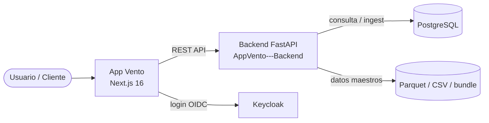

# Vento

**Herramienta web para identificar dónde tiene sentido instalar parques eólicos en Colombia.**

Un convenio entre la **ANH** (Agencia Nacional de Hidrocarburos) y la **Universidad EAFIT**, desarrollado por **Mavalan Software**, para acelerar la transición energética del país.

> Este README es la **vista general del proyecto** — pensado para que cualquiera
> (técnico o no) entienda qué es Vento, cómo está organizado y dónde encontrar
> cada cosa. Los detalles técnicos viven en [`docs/`](docs/).

---

## ¿Qué es Vento?

Vento es una aplicación web que muestra un **mapa interactivo de Colombia** dividido en pequeños hexágonos. El usuario elige una zona, indica las características del proyecto eólico que imagina y obtiene un **informe de idoneidad** que combina varias variables y criterios.

| Pregunta | Respuesta |
|----------|-----------|
| **¿Qué problema resuelve?** | Decidir dónde instalar un parque eólico normalmente toma semanas y obliga a cruzar datos de muchas fuentes. Vento reúne todo en un solo mapa. |
| **¿Para quién es?** | Analistas de energía, investigadores y tomadores de decisiones de la ANH y EAFIT. |
| **¿Qué muestra el mapa?** | Un mapa de calor: las zonas amarillas son las más aptas, las moradas las menos aptas. |
| **¿Qué evalúa?** | Una calificación general que combina 3 dimensiones puntuables — Ambiental, Técnica y Social (+ económica y Regulatoria, informativas). |
| **¿De dónde salen los datos?** | El equipo de investigación de EAFIT/ANH genera los datos ya procesados; Vento los muestra sobre el mapa. |

---

## ¿Cómo se usa?

El usuario avanza por cuatro pasos, en orden, desde el menú lateral:

```
1. Iniciar sesión (institucional)
        │
        ▼
2. Seleccionar el área en el mapa (en tierra o en el mar)
        │
        ▼
3. Elegir qué dimensiones y variables analizar
        │
        ▼
4. Indicar las características del proyecto (capacidad, tipo de aerogenerador)
        │
        ▼
   ➜ Informe de idoneidad (mapa de calor + calificaciones + descarga en PDF)
```

Se puede volver libremente a un paso anterior para ajustar la selección.

📖 Guía paso a paso para el usuario final: **[Manual de usuario](docs/manuales/manual-usuario.md)**.

---

## Estado del proyecto

| Etapa | Estado | En breve |
|-------|--------|----------|
| **Scope 1** — Acceso + Mapa + Administración | 🟢 Entregado | Login institucional, mapa de hexágonos y gestión de usuarios, funcionando en producción. |
| **Scope 2** — Flujo completo de idoneidad | 🟢 Entregado | Selección de área, variables, características e informe con PDF. |
| **Tercera entrega** — Feedback v2 + catálogo definitivo | 🟢 Entregado (modo template) | Catálogo definitivo de variables, informe (previsualización a pantalla completa, captura del mapa, etc.). |
| **Datos reales del modelo** | 🟠 Pendiente (externo) | Hoy el mapa usa datos de ejemplo; el equipo de investigación entregará los datos definitivos. |
| **Notificaciones por correo** | 🔴 Bloqueado (externo) | A la espera de que el cliente provea el servidor de correo (SMTP). |

Estado detallado, historia por historia: [`docs/project-status.md`](docs/project-status.md).

---

## Estructura del proyecto

El repositorio junta el software, su documentación y los entregables al cliente:

```
AppVento/
├── README.md              → Este archivo: la vista general del proyecto
│
├── Vento/                 → El software (frontend web, Next.js)
│   └── README.md            · Cómo levantar el proyecto en tu computador
│
├── docs/                  → Toda la documentación técnica y del proyecto
│   ├── README.md            · Índice maestro: por dónde empezar según tu rol
│   ├── manuales/            · Manuales usuario, técnico e instalación (.md/.svg/.html)
│   ├── entregas/            · Resúmenes de sprint y estimaciones (infografías .svg)
│   ├── stories/             · Qué se construye (historias, scopes, feedback, sprints)
│   ├── adr/                 · Decisiones de arquitectura (ADRs)
│   ├── architecture/        · Arquitectura del sistema y del stack
│   ├── testing/             · Cómo se prueba el software y cómo replicar las pruebas
│   ├── dev-notes/           · Notas técnicas de cómo funciona por dentro
│   ├── ops/ · infra/        · Cómo se despliega y opera (servidores, Keycloak)
│   └── security/            · Cómo funciona el inicio de sesión y la protección de rutas
│
├── Reportes_Entregas/     → Entregables formales al cliente (informes de cierre por fase)
│
└── infra/                 → Configuración de Keycloak (identidad / login)
```

El **backend** (el servidor que procesa y sirve los datos, hecho en Python/FastAPI) vive en un **repositorio aparte** (`AppVento---Backend`).

---

## Conexión con el backend

La app frontend consume el backend FastAPI para:
- renderizar hexágonos del mapa
- consultar variables y capas
- calcular el área seleccionada
- guardar el historial del usuario
- usar autenticación y catálogo administrativo

### Backend principal

- Repositorio: https://github.com/DimensionSwVento/AppVento---Backend
- README: https://github.com/DimensionSwVento/AppVento---Backend#readme
- Diagrama de arquitectura + endpoints: https://github.com/DimensionSwVento/AppVento---Backend#readme

> Si necesitas revisar la arquitectura, tablas de base de datos, endpoints completos o análisis de cuellos de botella, la referencia técnica está en ese repositorio.

### Diagramas de integración



### Uso estimado de endpoints según el flujo del frontend

El frontend no usa todos los endpoints por igual. La siguiente estimación es funcional, deducida del flujo del frontend y de la documentación del backend:

| Endpoint | Uso desde el frontend | Frecuencia esperada |
|----------|----------------------|---------------------|
| `GET /api/tiles/warmup` | arranque del mapa | 1 vez por sesión |
| `GET /api/tiles/variables` | cargar catálogo de variables | 1-2 veces por sesión |
| `GET /api/tiles/{z}/{x}/{y}` | render del mapa | muy alta, por pan/zoom |
| `GET /api/tiles/counts` | conteos por mapa/filtros | media |
| `GET /api/tiles/detail/{h3}` | popup de hexagono | baja a media |
| `POST /api/tiles/variable` | mostrar una variable/capa | media |
| `POST /api/tiles/variables-bulk` | varias capas juntas | media/alta |
| `POST /api/tiles/area` | cálculo por área / informe | media |
| `GET /api/historico` | historial de informes | baja |
| `POST /api/historico` | guardar informe | baja |
| `DELETE /api/historico/{id}` | borrar informe | muy baja |

### Qué es más pesado en práctica

Los endpoints que más presión generan sobre el backend en esta app son:

1. `GET /api/tiles/{z}/{x}/{y}`
   - se ejecuta mucho mientras se navega el mapa
2. `POST /api/tiles/variables-bulk`
   - aparece cuando se muestran varias capas a la vez
3. `POST /api/tiles/area`
   - ocurre al calcular el informe por zona

Los endpoints de historial y admin tienen un uso mucho menor en la sesión normal del usuario final.

---

## ¿Dónde encuentro…?

| Quiero… | Ir a |
|---------|------|
| **Levantar el proyecto en mi computador** | [`Vento/README.md`](Vento/README.md) |
| **Entender la documentación (soy dev nuevo, PM o stakeholder)** | [`docs/README.md`](docs/README.md) — índice maestro |
| **Usar el software como usuario final** | [Manual de usuario](docs/manuales/manual-usuario.md) |
| **Ver qué se entregó al cliente en cada fase** | [`Reportes_Entregas/`](Reportes_Entregas/) |
| **Saber qué se está construyendo ahora** | [`docs/stories/`](docs/stories/) |
| **Entender una decisión técnica** | [`docs/adr/`](docs/adr/) — registros de decisiones |
| **Ver la arquitectura técnica del backend** | [AppVento---Backend](https://github.com/DimensionSwVento/AppVento---Backend) |

---

## Equipo y contexto

| Aspecto | Detalle |
|---------|---------|
| **Convenio** | ANH — Universidad EAFIT |
| **Desarrollo** | Mavalan Software |
| **Fase** | Fase 2 (desarrollo de la herramienta SIG), con criterios hacia Fase 3 |
| **Metodología** | Ágil, con apoyo del framework BMAD para planificación asistida por IA |

---

## Glosario mínimo

| Término | En palabras simples |
|---------|---------------------|
| **SIG** | Sistema de Información Geográfica — un mapa que además guarda datos por cada zona. |
| **Hexágono / H3** | Colombia se divide en pequeños hexágonos; cada uno es una zona con su propia calificación. |
| **Idoneidad** | Qué tan apta es una zona para un proyecto eólico — un primer análisis antes de estudios costosos (antes "prefactibilidad"). |
| **Onshore / Offshore** | En tierra firme (onshore) o en el mar (offshore). |
| **Aerogenerador** | La turbina eólica — el "molino" que genera la energía. |
| **Mapa de calor (Viridis)** | La escala de color del mapa: amarillo = zona muy apta, morado = poco apta. |

> ¿Buscas el glosario técnico completo (H3, OIDC, WLC, tile-based, etc.)?
> Está en el [índice maestro de documentación](docs/README.md#glosario).

---

## 8. Cambios relevantes

| Fecha | Cambio |
|-------|--------|
| 2026-04-20 | Creación inicial del master doc tras consolidación post-feedback v1 |
| 2026-07-13 | v2.0 — reubicado a `docs/README.md`; estado actualizado a Sprint 3 (Scopes 1/2 y FB1/FB2 cerrados); stoppers al día |
| 2026-07-13 | Reorg: **`spec/` aplanado** — `adr/`, `architecture/`, `stories/`, `Spec_doc.md`, `project-status.md` promovidos a `docs/`; `reunion-pendiente` eliminado (obsoleto) |
| 2026-07-30 | v2.1 — **3ª entrega**: renombre idoneidad; dimensiones Social/económicao (61+30); §3.5 Procedimientos (modo template, compactación, PDF por captura); stoppers al día; `spec/` pulido |
| 2026-10-23 | Añadida referencia directa al backend `AppVento---Backend` con diagrama de integración y estimación de uso de endpoints por flujo frontend |

