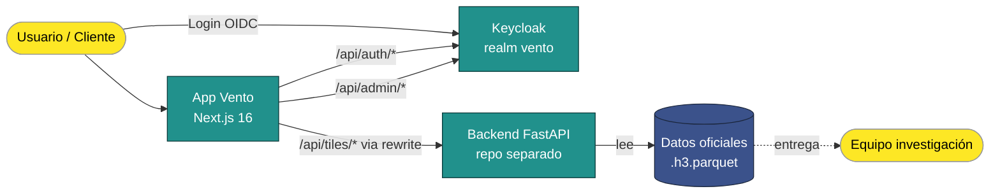

# Vento — Documentación Maestra

> **Punto único de entrada** a toda la documentación del proyecto Vento. Resume el estado, los stoppers y enlaza a docs específicas según lo que busques.

---

## TL;DR

**Vento** es una herramienta web SIG multicriterio para evaluar la prefactibilidad de proyectos de energía eólica (onshore y offshore) en Colombia. Convenio **ANH + EAFIT**, desarrollado por **Mavalan Software**.

- **Scope 1** (Acceso + Mapa + Admin): ✅ cerrado y desplegado en AccuWeb.
- **Scope 2** (flujo completo de prefactibilidad): ✅ cerrado (2026-06-01).
- **Feedback de rondas previas** (FB1, FB2): ✅ cerrados.
- **Sprint 3** (feedback v2 del Scope 2): 🔨 **en curso** — onboarding, histórico de informes, radar dinámico, y ajustes de mapa/UX. Detalle en [feedback-cliente-v2.md](stories/feedback-cliente-v2.md) y [sprint-3.md](stories/sprint-3.md).
- **Stoppers activos**: datos reales del modelo multicriterio (equipo de investigación) y SMTP institucional (cliente).

---

## 1. Diagrama del sistema

**Lectura rápida**: el usuario entra a Vento (Next.js), Keycloak gestiona quién es; cuando consulta el mapa, Vento le pide tiles al backend FastAPI; el backend lee los datos del equipo de investigación.

---

## 2. Estado del proyecto (semáforo)

> **Terminología:** US01–US09 son las **épicas / módulos** del proyecto (no historias). Las historias reales (US-FBx, US0x-AC…) viven en los docs de `stories/`. Scopes 1 y 2 y los feedbacks FB1/FB2 están **cerrados**; el trabajo activo es el **Sprint 3** (feedback v2).

| Módulo (épica) | Estado | Detalle |
|----------------|--------|---------|
| **US01 Acceso** | 🟢 Cerrado | Login institucional Keycloak (OIDC+PKCE). Falta **SMTP pago (MailerSend)** — externo. |
| **US02 Onboarding** | 🔨 Sprint 3 | Modal único por usuario · carrusel de 4 pasos · botón de cierre/salto. |
| **US03 Mapa** | 🟢 Cerrado | Selección H3 onshore/offshore. Faltan **pruebas con datos reales**; añadidos US03-02 (fix anidados) y US03-03 (zonas prohibidas). |
| **US04 Variables** | 🟢 Cerrado | Dimensiones + catálogo + cambios de alcance. Faltan **datos reales**. |
| **US05 Proyecto** | 🟢 Cerrado | Características del proyecto. Pendiente **negociar cambios de alcance**. |
| **US06 Reportes** | 🔨 Sprint 3 | Radar (spider chart) dinámico · export PDF con logos EAFIT/ANH. |
| **US07 Histórico** | 🔨 Sprint 3 | Listado cronológico (Hoy/Semana/Mes) · ver informes antiguos. |
| **US08 Admin** | 🟢 Cerrado | Gestión de usuarios CRUD. |
| **US09 UX/UI** | 🔨 Sprint 3 | Mensajes de confirmación (toasts) · alertas de error en validación. |

**Infra y transversales:** Tests unitarios 🟢 · Deploy AccuWeb 🟡 (CI estable en `main`, manual en `develop`) · Documentación 🟢 consolidada (stories + ADRs + arquitectura + dev-notes) · Modelo multicriterio 🟠 datos placeholder hasta ingesta real · SMTP 🔴 bloqueado (cliente).

Leyenda: 🟢 cerrado · 🔨 en curso (Sprint 3) · 🟡 parcial · 🟠 en proceso externo · 🔴 bloqueado externo

---

## 3. Stoppers y riesgos vigentes

| # | Stopper | Tipo | Impacto | ADR / Doc |
|---|---------|------|---------|-----------|
| 1 | **Datos reales del modelo multicriterio** todavía no ingeridos | Externo (investigación / Camila) | El mapa y los scores usan placeholders; bloquea US03-01, US04-01 y poblar zonas prohibidas (US03-03) | [sprint-3 §precondiciones](stories/sprint-3.md) |
| 2 | Cliente no ha entregado **servidor SMTP pago (MailerSend)** | Externo (cliente) | Bloquea notificación email + recovery password (US01-01) | [ADR-009](adr/ADR-009-notificaciones-email-pendientes-smtp.md) |
| 3 | **Cambios de alcance de US05** por negociar | Externo (reunión cliente) | US05-01 a la espera de definición | [sprint-3 US05-01](stories/sprint-3.md) |
| 4 | **CI GitHub Actions** inestable en ramas de desarrollo | Interno | Deploys vía CI solo confiables tras llegar a `main`; deploy manual en `develop` | [accuweb-runbook §8](ops/accuweb-runbook.md#8-pipeline-ci--estado-y-troubleshooting) |

---

## 4. Índice navegable

> Cada archivo lleva una línea de "qué encontrarás ahí" para no abrir 20 docs buscando.

### Para el cliente y stakeholders no técnicos

| Doc | Para qué |
|-----|----------|
| [Spec_doc.md](Spec_doc.md) | Visión, problema, objetivos, flujo de usuario, dimensiones (4 puntuables + Regulatoria informativa), tipos de variables |
| [project-status.md](project-status.md) | Tabla de estado del proyecto, índice maestro de docs, actividades hechas y pendientes |
| [manual-usuario.md](manual-usuario.md) | Guía paso a paso para el **usuario final** del software |
| Este archivo (`docs/README.md`) | Punto de entrada general — qué es Vento y dónde mirar |

### Para gestión del proyecto y stakeholders técnicos

| Doc | Para qué |
|-----|----------|
| [scope-primera-entrega.md](stories/scope-primera-entrega.md) | 20 historias contractuales de la primera entrega (US01, US03, US08, etc.) |
| [scope-dos.md](stories/scope-dos.md) | 16 sub-historias de la segunda entrega (US03P2, US04, US05, US06) — ✅ cerrado (2026-06-01) |
| [feedback-cliente-v1.md](stories/feedback-cliente-v1.md) | 7 HUs derivadas del feedback post-deploy v1 (Keycloak ES, expiración sesión, territorio insular, admin roles, …) |
| [feedback-1-round2.md](stories/feedback-1-round2.md) | Feedback ronda 2 — evaluación de terceros tras deploy v1 (5 HUs derivadas + items descartados con razón) |
| [tecnologias.md](architecture/tecnologias.md) | Comparativa de opciones tecnológicas (parcialmente histórico — ver [tech-stack-validation.md](architecture/tech-stack-validation.md)) |

### Para desarrolladores nuevos

| Doc | Para qué |
|-----|----------|
| [tech-stack-validation.md](architecture/tech-stack-validation.md) | Qué tecnologías se usan y por qué — retrospectiva práctica del stack |
| [frontend-backend-integration.md](architecture/frontend-backend-integration.md) | Cómo Next.js se conecta a FastAPI (rewrites, proxy, dónde van los handlers locales vs proxy) |
| [auth-strategy.md](security/auth-strategy.md) | Cómo funciona el login y la protección de rutas (middleware + layouts + API guards) |
| [infra/keycloak.md](infra/keycloak.md) | Cómo desplegar y configurar Keycloak para Vento (dev + prod, theme, realm) |
| [test-strategy.md](testing/test-strategy.md) | Estrategia de testing: dónde viven los tests, qué validan, cómo añadir nuevos |
| [accuweb-runbook.md](ops/accuweb-runbook.md) | Cómo desplegar, monitorear y troubleshoot Vento en AccuWeb (incluye onboarding) |
| [dev-notes/map-rendering.md](dev-notes/map-rendering.md) | Detalles del renderizado de mapa (DeckGL + MapLibre + TileLayer) |
| [dev-notes/h3-data-pipeline.md](dev-notes/h3-data-pipeline.md) | Pipeline de datos H3 (de `.parquet` a tiles JSON) |
| [dev-notes/navigation-state-machine.md](dev-notes/navigation-state-machine.md) | Máquina de estados del flujo (selección → dimensiones → características → informe) |

### ADRs (Architecture Decision Records)

| ADR | Decisión | Estado |
|-----|----------|--------|
| [ADR-001](adr/ADR-001-stack-frontend.md) | Stack frontend | ✅ Aceptado (validado en producción, Next.js 16) |
| [ADR-002](adr/ADR-002-resolucion-h3.md) | Resolución H3 | ✅ Aceptado (refinado por ADR-008 tile-based) |
| [ADR-003](adr/ADR-003-sin-backend-api-inicial.md) | Sin backend API inicial | ⛔ Superseded por ADR-007 |
| [ADR-004](adr/ADR-004-equipo-viabilidad-1-mes.md) | Equipo y viabilidad 1 mes | ✅ Aceptado |
| [ADR-005](adr/ADR-005-keycloak-identidad.md) | Keycloak como proveedor de identidad | ✅ Aceptado |
| [ADR-006](adr/ADR-006-storage-cache-datos-geoespaciales.md) | Storage y cache geoespacial | ✅ Aceptado |
| [ADR-007](adr/ADR-007-backend-clean-architecture-ddd-monorepo.md) | Backend Clean Architecture + DDD | ✅ Aceptado (repos separados, no monorepo) |
| [ADR-008](adr/ADR-008-arquitectura-tile-based.md) | Arquitectura tile-based | ✅ Aceptado |
| [ADR-009](adr/ADR-009-notificaciones-email-pendientes-smtp.md) | Notificaciones email pendientes SMTP | 🔴 Bloqueado externo |
| [ADR-010](adr/ADR-010-hosting-accuweb-vs-supabase-vercel.md) | Hosting AccuWeb vs Supabase+Vercel | ✅ Aceptado |
| [ADR-011](adr/ADR-011-parquet-procesamiento-backend-no-browser.md) | Parquet backend, no browser | ✅ Aceptado |
| [ADR-012](adr/ADR-012-post-registration-confirmation-app-side.md) | Confirmación post-registro app-side | ✅ Aceptado |
| ADR-013 | PDF generation lib (WeasyPrint / ReportLab / jsPDF) | ✅ Aceptado — el cliente permitió usar cualquiera a conveniencia del equipo |
| [ADR-014](adr/ADR-014-validacion-per-tile-point-in-polygon.md) | Validación per-tile point-in-polygon (sin cache global de Colombia) | ✅ Aceptado |
| ADR-015 | Catálogo aerogeneradores: JSON vs BE | ✅ Resuelto en reunión datos — el catálogo + restricciones se cubren en US05-AC1/AC2/AC3 |

---

## 5. Cómo empezar según tu rol

### Soy del **cliente / stakeholder no técnico**
1. Lee §1 Diagrama y §2 Estado.
2. Si quieres entender qué hace Vento: [Spec_doc.md](Spec_doc.md).
3. Si quieres ver qué se entregó y qué falta: [project-status.md](project-status.md).
4. Si tienes feedback nuevo: lo capturaremos en una próxima ronda (`feedback-cliente-vN.md`).

### Soy **PM / coordinador**
1. Lee este master + [project-status.md](project-status.md).
2. Para asignar trabajo: [scope-primera-entrega.md](stories/scope-primera-entrega.md), [feedback-cliente-v1.md](stories/feedback-cliente-v1.md), [scope-dos.md](stories/scope-dos.md).
3. Para entender decisiones técnicas: navega los [ADRs](adr/).
4. Las HUs se sincronizan a GitHub Issues vía `.github/workflows/sync-stories.yml`.

### Soy **dev nuevo en el equipo**
1. Lee §1 Diagrama y §4 → carpeta "Para desarrolladores nuevos".
2. Setup local: [accuweb-runbook §13 Onboarding](ops/accuweb-runbook.md#13-onboarding-rápido-para-nuevo-dev).
3. Antes de tocar auth: [auth-strategy.md](security/auth-strategy.md).
4. Antes de tocar el mapa: [dev-notes/map-rendering.md](dev-notes/map-rendering.md).
5. Antes de hacer PR: [test-strategy.md](testing/test-strategy.md).
6. Toma una HU del **Sprint 3** en [sprint-3.md](stories/sprint-3.md) o [feedback-cliente-v2.md](stories/feedback-cliente-v2.md) que no esté asignada.

### Soy **DevOps / on-call**
1. [accuweb-runbook.md](ops/accuweb-runbook.md) — completo.
2. [infra/keycloak.md](infra/keycloak.md) — para temas de IdP.
3. Si CI falla en `develop`: §8 del runbook.

---

## 6. Glosario

| Término | Qué significa en Vento |
|---------|------------------------|
| **H3** | Sistema de indexación geoespacial de Uber que divide el mundo en hexágonos. Vento usa H3 para discretizar Colombia (resoluciones 3-8 según zoom). |
| **Hexágono / cell / tile** | Un hexágono H3. La unidad mínima de análisis del mapa. Cada hex tiene un score y variables. |
| **Resolución H3** | Tamaño del hex. Res 3 ≈ 68 km de borde; res 8 ≈ 460 m. Más resolución = más detalle pero más datos. |
| **Tile-based** | Patrón de renderizado: la app pide solo los hexágonos visibles en pantalla, no todos a la vez. |
| **OIDC** | OpenID Connect. Protocolo estándar para login federado — Keycloak lo implementa. |
| **Realm** | Espacio de Keycloak donde viven los usuarios, roles y clientes. Vento usa el realm `vento`. |
| **Cliente Keycloak** | App que pide tokens al realm. Aquí es `vento-web` (confidencial). |
| **JWT / JWE** | Token cifrado/firmado. Vento usa JWE para la cookie de sesión (refreshToken + roles). |
| **NextAuth** | Librería que conecta Next.js con Keycloak vía OIDC. |
| **FastAPI** | Framework Python para el backend. Sirve los tiles H3 y endpoints de datos. |
| **`.h3.parquet`** | Archivo binario con datos geoespaciales por hexágono — entregado por el equipo de investigación. |
| **Modelo multicriterio** | Algoritmo del equipo de investigación que calcula scores de viabilidad eólica por hex. En desarrollo. |
| **Score general** | Promedio ponderado (WLC) de las **4 dimensiones puntuables** para un hexágono. |
| **Dimensiones** | Técnica, ambiental, socioeconómica, macroeconómica (**4 puntuables**) + Regulatoria (**informativa** desde US-FB3-06). |
| **Variables incluyentes / penalizantes / excluyentes** | Tipos de variable según cómo afectan el score (suman, restan, eliminan zona). |
| **ZEE** | Zona Económica Exclusiva — territorio marítimo. Vento permite seleccionar hexágonos offshore en la ZEE colombiana (incluido San Andrés y Providencia). |
| **AccuWeb** | Proveedor de hosting donde corre Vento en producción. |
| **cPanel** | Panel de gestión del hosting AccuWeb. Auto-deploya desde ramas `deploy-test`/`deploy-prod`. |
| **ADR** | Architecture Decision Record. Documento que registra una decisión técnica, su contexto y consecuencias. |
| **HU (Historia de Usuario)** | Unidad de trabajo: "Como X quiero Y para Z" + criterios de aceptación. |
| **AC (Criterio de Aceptación)** | Cláusula verificable que dice cuándo una HU está "lista". |
| **Standalone** | Modo de build de Next.js que produce un servidor Node minimalista sin necesidad de `npm install` en producción. |
| **SMTP** | Protocolo de envío de email. Vento depende del cliente para proveerlo (bloqueante ADR-009). |

---

## 7. Mantenimiento de este documento

**Revisar mensualmente** estos 6 puntos. Si alguno cambia, actualiza la sección correspondiente:

1. ¿El semáforo de §2 sigue reflejando la realidad?
2. ¿Hay stoppers nuevos en §3 o alguno se resolvió?
3. ¿Aparecieron docs nuevos? → añadir al índice §4
4. ¿Algún ADR cambió de estado (propuesto → aceptado, o aceptado → superseded)?
5. ¿Hay nuevos términos técnicos no explicados en el glosario?
6. Fecha de la última revisión arriba en el frontmatter.

**Mantenedor**: Mavalan Software. Si otro dev edita, marca el cambio en commit message como `docs(master): ...` para no pasar desapercibido.

---

## 8. Cambios relevantes

| Fecha | Cambio |
|-------|--------|
| 2026-04-20 | Creación inicial del master doc tras consolidación post-feedback v1 |
| 2026-07-13 | v2.0 — reubicado a `docs/README.md`; estado actualizado a Sprint 3 (Scopes 1/2 y FB1/FB2 cerrados); stoppers al día |
| 2026-07-13 | Reorg: **`spec/` aplanado** — `adr/`, `architecture/`, `stories/`, `Spec_doc.md`, `project-status.md` promovidos a `docs/`; `reunion-pendiente` eliminado (obsoleto) |
| 2026-07-13 | `futuros-sprints.md` eliminado (fases finales); `Spec_doc.md` → v2.0 (flujo, stack y dimensiones al día); ADR-001/002 marcados aceptados |
