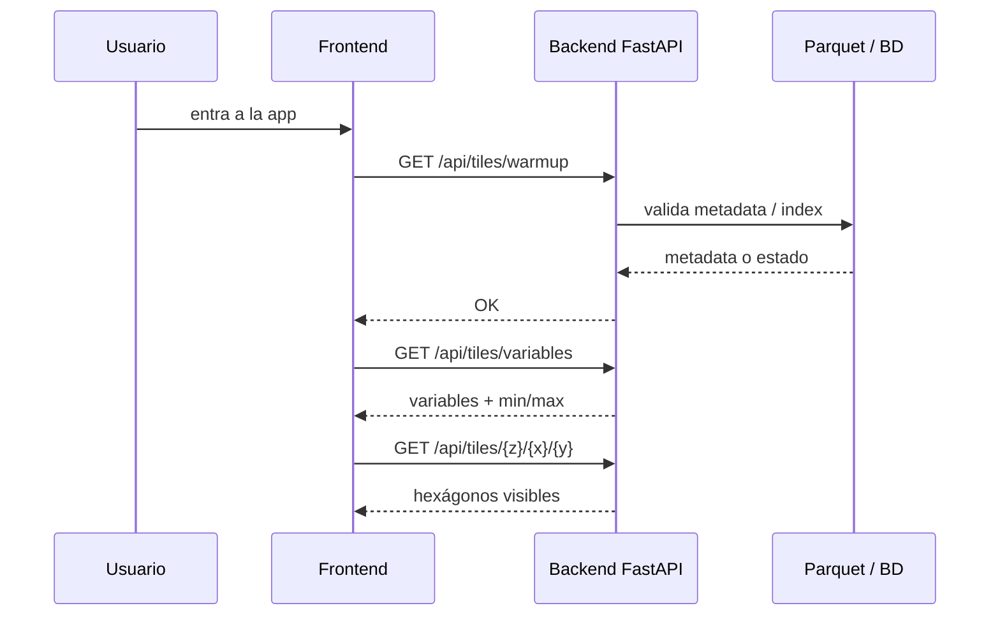
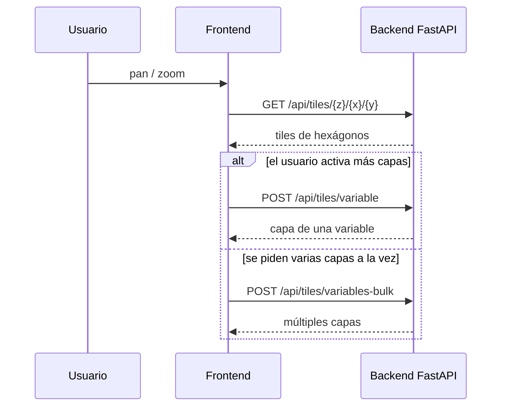
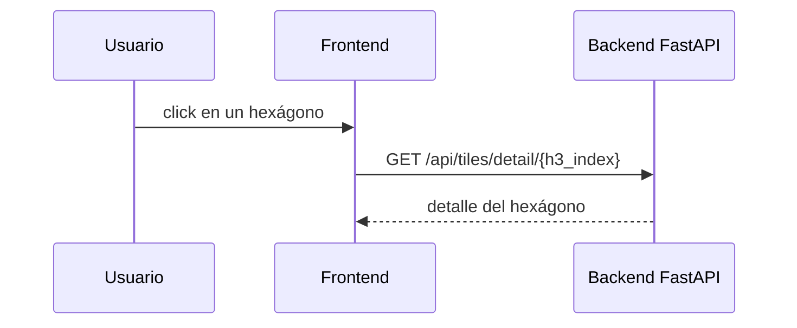
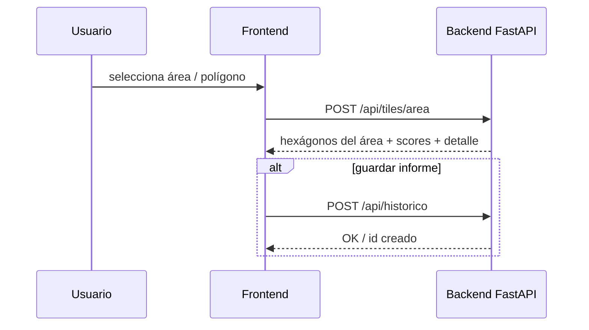

# Diagrama de integración y uso

Este documento muestra la arquitectura real del sistema en la parte que consume el frontend de Vento y el backend FastAPI. No incluye todo el backend administrativo ni todos los submódulos de ingesta; solo concentra lo que usa la app de usuario final en la ruta principal del producto.

---

## 1. Vista de arquitectura

```mermaid
flowchart LR
    U([Usuario]) --> APP[Frontend Next.js\nVento]
    APP -->|OIDC / login| KC[Keycloak\nrealm vento]
    APP -->|rewrite / proxy| R[/api/tiles/*\nNext.js -> FastAPI]
    APP -->|histórico / guardar informe| H[/api/historico\nFastAPI]

    R --> BE[Backend FastAPI\nAppVento---Backend]
    H --> BE
    BE -->|consultas geoespaciales| PG[(PostgreSQL)]
    BE -->|datos maestros| PAR[(Parquet / CSV / bundle)]

    BE --> T[Tiles + capas + área + scoring]
    T --> APP
```

### Qué representa este diagrama

- El frontend es la capa de experiencia de usuario y UI.
- Keycloak gestiona autenticación y roles.
- El frontend no habla directamente con la BD ni con Parquet; usa FastAPI como API backend.
- Los endpoints usados por la app de usuario final viven bajo `/api` y principalmente en `tiles` y `historico`.
- La lógica pesada (mapa, scores, geo, layer rendering) se hace en el backend.

---

## 2. Endpoints que consume el frontend del backend

Los siguientes son los endpoints del backend que la aplicación del usuario final usa realmente:

| Endpoint | Qué hace | Frecuencia esperada | Nivel de costo |
|----------|----------|--------------------|----------------|
| `GET /api/tiles/warmup` | arranque del mapa, inicializa metadata y estado | 1 vez por sesión | bajo |
| `GET /api/tiles/variables` | devuelve variables disponibles y metadata | 1–2 veces por sesión | bajo |
| `GET /api/tiles/{z}/{x}/{y}` | tiles del mapa, hexágonos visibles | muy alta | alto |
| `GET /api/tiles/counts` | conteos globales por zoom/variable/selección | media | medio |
| `GET /api/tiles/detail/{h3_index}` | detalle de un hexágono | baja | bajo |
| `POST /api/tiles/variable` | capa de una variable específica | media | medio/alto |
| `POST /api/tiles/variables-bulk` | varias capas del mapa a la vez | media/alta | muy alto |
| `POST /api/tiles/area` | cálculo del área seleccionada + scores | media | alto |
| `GET /api/historico` | lista de informes del usuario | baja | bajo |
| `POST /api/historico` | guardar informe | baja | bajo |
| `DELETE /api/historico/{id}` | borrar informe | muy baja | bajo |

### Endpoints no incluidos por diseño

Estos no forman parte del flujo principal del frontend de usuario final y por eso no se dibujan en este diagrama:

- `/api/admin/*`
- `/api/admin/catalog/*`
- `/api/admin/master/*`
- `/api/admin/bundle/*`
- `/api/admin/db/*`
- `/api/_debug/*`

Se reservan para administración, ingesta de catálogo y diagnóstico operativo.

---

## 3. Flujo principal por pantalla

### 3.1 Arranque del mapa



Este flujo suele ejecutarse 1 vez al abrir la app y luego al recargar / volver a entrar.

### 3.2 Navegación del mapa



### 3.3 Click en un hexágono



### 3.4 Generación del informe / área



---

## 4. Qué es más usado en la sesión normal del usuario

La intensidad de uso del backend se puede deducir por la navegación real del usuario:

### Uso principal

1. `GET /api/tiles/{z}/{x}/{y}`
   - es la más repetida en un mapa interactivo
   - ocurre en cada pan, zoom y render

2. `POST /api/tiles/variables-bulk`
   - aparece cuando se quiere mostrar varias capas al mismo tiempo
   - suele ser la más costosa de la UI

3. `POST /api/tiles/area`
   - se usa al calcular un informe por área o zona seleccionada
   - es crítica funcionalmente y también costosa

### Uso secundario

- `GET /api/tiles/variables` se usa al inicio y cuando se actualiza el catálogo
- `GET /api/tiles/detail/{h3_index}` se usa solo cuando se hace click sobre un hex
- `GET /api/historico` y `POST /api/historico` son eventos puntuales, no flujo continuo

### Uso que no debe considerarse patrón principal del usuario final

- endpoints bajo `/api/admin/*` no son consumo normal del usuario final
- por eso no forman parte del diagrama de integración operativa del front

---

## 5. Patr��n de carga útil para rendimiento

Para detectar cuellos de botella con datasets grandes, el “contador de sesión” más útil es:

| Indicador | Qué mide | Umbral rojo |
|-----------|----------|-------------|
| `expensive_calls_session` | llamadas costosas en una sesión | > 10 |
| `db_roundtrips_session` | consultas SQL por sesión | > 80 |
| `rows_scanned_session` | filas leídas durante la sesión | > 150M |
| `p95_latency_ms` | latencia p95 por endpoint | > 2000 ms |

Con este frontend, los puntos críticos esperados son:

- `/api/tiles/{z}/{x}/{y}` en zoom continuo
- `/api/tiles/variables-bulk` durante múltiples capas
- `/api/tiles/area` en el cálculo del informe

Estos tres son los candidatos principales a cuello de botella cuando el dataset supera 30M filas.

---

## 6. Resumen ejecutivo

La integración real del sistema es:

- Frontend Next.js → Keycloak para identidad
- Frontend → FastAPI backend para mapa, variables y datos geoespaciales
- FastAPI → PostgreSQL / Parquet para datos reales
- la app de usuario final NO usa el backend administrativo de /admin

La ruta más importante para el usuario es la del mapa y el cálculo del área:

```text
GET /api/tiles/warmup
GET /api/tiles/variables
GET /api/tiles/{z}/{x}/{y}
POST /api/tiles/variable / variables-bulk
GET /api/tiles/detail/{h3_index}
POST /api/tiles/area
GET /api/historico / POST /api/historico
```

Esto es lo esencial para entender cómo se integra el frontend con el backend y dónde probablemente se concentran los cuellos de botella de rendimiento.

---

## 7. Enlace técnico completo

Para el backend completo, tablas, endpoints admin, modelo de datos y análisis de rendimiento para datasets grandes, ir a:

- https://github.com/DimensionSwVento/AppVento---Backend
- README del backend: https://github.com/DimensionSwVento/AppVento---Backend#readme

