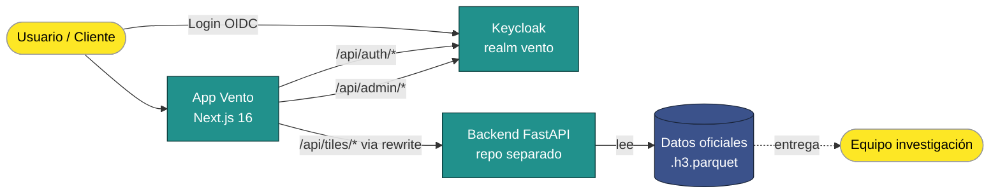

# Vento — Documentación Maestra

> **Punto único de entrada** a toda la documentación del proyecto Vento. Resume el estado, los stoppers y enlaza a docs específicas según lo que busques.

---

## TL;DR

**Vento** es una herramienta web SIG multicriterio para evaluar la viabilidad de proyectos de energía eólica (onshore y offshore) en Colombia. Cliente principal: **mavalan Software** con respaldo de **ANH** y **EAFIT**.

- **Primera entrega**: ✅ desplegada en AccuWeb. Cliente revisó y dejó feedback (atendido en sprint de estabilización).
- **Segunda entrega**: 🔨 en diseño, 16 sub-historias bloqueadas en parte por 2 reuniones pendientes (catálogo aerogeneradores + paleta colores).
- **Stoppers activos**: SMTP del cliente (notificación email) y avance del modelo multicriterio (datos reales en informes).

---

## 1. Diagrama del sistema

**Lectura rápida**: el usuario entra a Vento (Next.js), Keycloak gestiona quién es; cuando consulta el mapa, Vento le pide tiles al backend FastAPI; el backend lee los datos del equipo de investigación.

---

## 2. Estado del proyecto (semáforo)

| Bloque | Estado | Detalle |
|--------|--------|---------|
| **Primera entrega contractual** (US01, US03P1, US08) | 🟢 Entregado | Login, selección H3, admin de usuarios funcionando en AccuWeb |
| **Feedback cliente v1** (11 items consolidados en 7 HUs) | 🟡 Parcial | 5 de 7 HUs cerradas. Pendientes: Keycloak en español (US-FB-01) y notificación email (US-FB-06 bloqueado por SMTP) |
| **Tests unitarios** | 🟢 21 archivos, ~70 casos | Cobertura: auth, middleware, admin, navegación, mapa, ruta de logout, SessionGuard |
| **Deploy AccuWeb** | 🟡 Dual modo | CI estable solo en `main`; en `develop` el deploy es manual hasta arreglar reubicación de workflows |
| **Documentación técnica** | 🟢 Consolidada | 6 docs principales + 13 ADRs + dev-notes |
| **Segunda entrega contractual** (US03P2, US04, US05, US06) | 🔵 Diseñada | 16 sub-HUs definidas en `scope-dos.md`, 2 reuniones pendientes antes de arrancar |
| **Modelo multicriterio (datos del informe)** | 🟠 En desarrollo | Equipo investigación todavía entrega scores preliminares — usamos placeholders en informes |
| **SMTP institucional** | 🔴 Bloqueado | Cliente no ha provisto servidor SMTP — bloquea verify email, reset password, notificaciones admin (ADR-009) |

Leyenda: 🟢 ok · 🟡 parcial · 🔵 planeado · 🟠 en proceso externo · 🔴 bloqueado externo

---

## 3. Stoppers y riesgos vigentes

| # | Stopper | Tipo | Impacto | ADR / Doc |
|---|---------|------|---------|-----------|
| 1 | Cliente no ha entregado **servidor SMTP** | Externo | Bloquea US-FB-06 (notificación admin) + US01.3 (recovery password) | [ADR-009](../spec/adr/ADR-009-notificaciones-email-pendientes-smtp.md) |
| 2 | **Catálogo de aerogeneradores** no definido | Externo (cliente + datos) | Bloquea US05-AC1/AC2/AC3/AC5 | [scope-dos §Reuniones](../spec/stories/scope-dos.md#reuniones-requeridas) |
| 3 | **Modelo multicriterio** todavía preliminar | Externo (investigación) | US06-AC5 esperando — los informes usan placeholders mientras tanto | [scope-dos US06-AC5](../spec/stories/scope-dos.md#us06-ac5--conexión-a-datos-reales-del-modelo-multicriterio) |
| 4 | **CI GitHub Actions** inestable en ramas de desarrollo | Interno | Deploys vía CI solo confiables tras llegar a `main`; deploy manual en `develop` | [accuweb-runbook §8](../ops/accuweb-runbook.md#8-pipeline-ci--estado-y-troubleshooting) |
| 5 | **Bus factor = 1** (winx concentra full-stack + DevOps + coordinación) | Interno | Si winx no está, no hay backup operativo | Mitigación: [accuweb-runbook](../ops/accuweb-runbook.md) + onboarding part-time |

---

## 4. Índice navegable

> Cada archivo lleva una línea de "qué encontrarás ahí" para no abrir 20 docs buscando.

### Para el cliente y stakeholders no técnicos

| Doc | Para qué |
|-----|----------|
| [Spec_doc.md](../spec/Spec_doc.md) | Visión, problema, objetivos, flujo de usuario, 5 dimensiones, tipos de variables |
| [project-status.md](../spec/project-status.md) | Tabla de estado del proyecto, índice maestro de docs, actividades hechas y pendientes |
| Este archivo (`master/README.md`) | Punto de entrada general — qué es Vento y dónde mirar |

### Para gestión del proyecto y stakeholders técnicos

| Doc | Para qué |
|-----|----------|
| [scope-primera-entrega.md](../spec/stories/scope-primera-entrega.md) | 20 historias contractuales de la primera entrega (US01, US03, US08, etc.) |
| [scope-dos.md](../spec/stories/scope-dos.md) | 16 sub-historias de la segunda entrega (US03P2, US04, US05, US06) — diseño en curso |
| [feedback-cliente-v1.md](../spec/stories/feedback-cliente-v1.md) | 7 HUs derivadas del feedback post-deploy v1 (Keycloak ES, expiración sesión, territorio insular, admin roles, …) |
| [feedback-cliente-v2.md](../spec/stories/feedback-cliente-v2.md) | Placeholder — se llenará tras la demo de scope-dos |
| [tecnologias.md](../spec/architecture/tecnologias.md) | Comparativa de opciones tecnológicas (parcialmente histórico — ver [tech-stack-validation.md](../architecture/tech-stack-validation.md)) |
| [reunion-pendiente-decisiones-arquitectura.md](../spec/reunion-pendiente-decisiones-arquitectura.md) | Convocatoria a reunión multidisciplinaria pendiente |

### Para desarrolladores nuevos

| Doc | Para qué |
|-----|----------|
| [tech-stack-validation.md](../architecture/tech-stack-validation.md) | Qué tecnologías se usan y por qué — retrospectiva práctica del stack |
| [frontend-backend-integration.md](../architecture/frontend-backend-integration.md) | Cómo Next.js se conecta a FastAPI (rewrites, proxy, dónde van los handlers locales vs proxy) |
| [auth-strategy.md](../security/auth-strategy.md) | Cómo funciona el login y la protección de rutas (middleware + layouts + API guards) |
| [infra/keycloak.md](../infra/keycloak.md) | Cómo desplegar y configurar Keycloak para Vento (dev + prod, theme, realm) |
| [test-strategy.md](../testing/test-strategy.md) | Estrategia de testing: dónde viven los tests, qué validan, cómo añadir nuevos |
| [accuweb-runbook.md](../ops/accuweb-runbook.md) | Cómo desplegar, monitorear y troubleshoot Vento en AccuWeb (incluye onboarding) |
| [dev-notes/map-rendering.md](../dev-notes/map-rendering.md) | Detalles del renderizado de mapa (DeckGL + MapLibre + TileLayer) |
| [dev-notes/h3-data-pipeline.md](../dev-notes/h3-data-pipeline.md) | Pipeline de datos H3 (de `.parquet` a tiles JSON) |
| [dev-notes/navigation-state-machine.md](../dev-notes/navigation-state-machine.md) | Máquina de estados del flujo (selección → dimensiones → características → informe) |

### ADRs (Architecture Decision Records)

| ADR | Decisión | Estado |
|-----|----------|--------|
| [ADR-001](../spec/adr/ADR-001-stack-frontend.md) | Stack frontend | ⚠️ Propuesto (validado en práctica con Next.js 16) |
| [ADR-002](../spec/adr/ADR-002-resolucion-h3.md) | Resolución H3 | ⚠️ Propuesto |
| [ADR-003](../spec/adr/ADR-003-sin-backend-api-inicial.md) | Sin backend API inicial | ⛔ Superseded por ADR-007 |
| [ADR-004](../spec/adr/ADR-004-equipo-viabilidad-1-mes.md) | Equipo y viabilidad 1 mes | ✅ Aceptado |
| [ADR-005](../spec/adr/ADR-005-keycloak-identidad.md) | Keycloak como proveedor de identidad | ✅ Aceptado |
| [ADR-006](../spec/adr/ADR-006-storage-cache-datos-geoespaciales.md) | Storage y cache geoespacial | ✅ Aceptado |
| [ADR-007](../spec/adr/ADR-007-backend-clean-architecture-ddd-monorepo.md) | Backend Clean Architecture + DDD | ✅ Aceptado (repos separados, no monorepo) |
| [ADR-008](../spec/adr/ADR-008-arquitectura-tile-based.md) | Arquitectura tile-based | ✅ Aceptado |
| [ADR-009](../spec/adr/ADR-009-notificaciones-email-pendientes-smtp.md) | Notificaciones email pendientes SMTP | 🔴 Bloqueado externo |
| [ADR-010](../spec/adr/ADR-010-hosting-accuweb-vs-supabase-vercel.md) | Hosting AccuWeb vs Supabase+Vercel | ✅ Aceptado |
| [ADR-011](../spec/adr/ADR-011-parquet-procesamiento-backend-no-browser.md) | Parquet backend, no browser | ✅ Aceptado |
| [ADR-012](../spec/adr/ADR-012-post-registration-confirmation-app-side.md) | Confirmación post-registro app-side | ✅ Aceptado |
| ADR-013 (pendiente) | PDF: WeasyPrint vs ReportLab vs jsPDF | 🔵 Por escribir antes de US06 |
| ADR-014 (pendiente) | Catálogo aerogeneradores: JSON vs BE | 🔵 Por escribir tras reunión datos |

---

## 5. Cómo empezar según tu rol

### Soy del **cliente / stakeholder no técnico**
1. Lee §1 Diagrama y §2 Estado.
2. Si quieres entender qué hace Vento: [Spec_doc.md](../spec/Spec_doc.md).
3. Si quieres ver qué se entregó y qué falta: [project-status.md](../spec/project-status.md).
4. Si tienes feedback nuevo: lo capturaremos en `feedback-cliente-v2.md`.

### Soy **PM / coordinador**
1. Lee este master + [project-status.md](../spec/project-status.md).
2. Para asignar trabajo: [scope-primera-entrega.md](../spec/stories/scope-primera-entrega.md), [feedback-cliente-v1.md](../spec/stories/feedback-cliente-v1.md), [scope-dos.md](../spec/stories/scope-dos.md).
3. Para entender decisiones técnicas: navega los [ADRs](../spec/adr/).
4. Las HUs se sincronizan a GitHub Issues vía `.github/workflows/sync-stories.yml`.

### Soy **dev nuevo en el equipo**
1. Lee §1 Diagrama y §4 → carpeta "Para desarrolladores nuevos".
2. Setup local: [accuweb-runbook §13 Onboarding](../ops/accuweb-runbook.md#13-onboarding-rápido-para-nuevo-dev).
3. Antes de tocar auth: [auth-strategy.md](../security/auth-strategy.md).
4. Antes de tocar el mapa: [dev-notes/map-rendering.md](../dev-notes/map-rendering.md).
5. Antes de hacer PR: [test-strategy.md](../testing/test-strategy.md).
6. Toma una HU "✅ Listo" de [scope-dos.md](../spec/stories/scope-dos.md) o algún `feedback-cliente-v1` no asignado.

### Soy **DevOps / on-call**
1. [accuweb-runbook.md](../ops/accuweb-runbook.md) — completo.
2. [infra/keycloak.md](../infra/keycloak.md) — para temas de IdP.
3. Si CI falla en `develop`: §8 del runbook.

---

## 6. Glosario

| Término | Qué significa en Vento |
|---------|------------------------|
| **H3** | Sistema de indexación geoespacial de Uber que divide el mundo en hexágonos. Vento usa H3 para discretizar Colombia (resoluciones 3-8 según zoom). |
| **Hexágono / cell / tile** | Un hexágono H3. La unidad mínima de análisis del mapa. Cada hex tiene un score y variables. |
| **Resolución H3** | Tamaño del hex. Res 3 ≈ 68 km de borde; res 8 ≈ 460 m. Más resolución = más detalle pero más datos. |
| **Tile-based** | Patrón de renderizado: la app pide solo los hexágonos visibles en pantalla, no todos a la vez. |
| **OIDC** | OpenID Connect. Protocolo estándar para login federado — Keycloak lo implementa. |
| **Realm** | Espacio de Keycloak donde viven los usuarios, roles y clientes. Vento usa el realm `vento`. |
| **Cliente Keycloak** | App que pide tokens al realm. Aquí es `vento-web` (confidencial). |
| **JWT / JWE** | Token cifrado/firmado. Vento usa JWE para la cookie de sesión (refreshToken + roles). |
| **NextAuth** | Librería que conecta Next.js con Keycloak vía OIDC. |
| **FastAPI** | Framework Python para el backend. Sirve los tiles H3 y endpoints de datos. |
| **`.h3.parquet`** | Archivo binario con datos geoespaciales por hexágono — entregado por el equipo de investigación. |
| **Modelo multicriterio** | Algoritmo del equipo de investigación que calcula scores de viabilidad eólica por hex. En desarrollo. |
| **Score general** | Promedio ponderado de las 5 dimensiones de viabilidad para un hexágono. |
| **Dimensiones** | Técnica, ambiental, regulatoria, socioeconómica, macroeconómica. Las 5 categorías de variables del análisis. |
| **Variables incluyentes / penalizantes / excluyentes** | Tipos de variable según cómo afectan el score (suman, restan, eliminan zona). |
| **ZEE** | Zona Económica Exclusiva — territorio marítimo. Vento permite seleccionar hexágonos offshore en la ZEE colombiana (incluido San Andrés y Providencia). |
| **AccuWeb** | Proveedor de hosting donde corre Vento en producción. |
| **cPanel** | Panel de gestión del hosting AccuWeb. Auto-deploya desde ramas `deploy-test`/`deploy-prod`. |
| **ADR** | Architecture Decision Record. Documento que registra una decisión técnica, su contexto y consecuencias. |
| **HU (Historia de Usuario)** | Unidad de trabajo: "Como X quiero Y para Z" + criterios de aceptación. |
| **AC (Criterio de Aceptación)** | Cláusula verificable que dice cuándo una HU está "lista". |
| **Bus factor** | Cuántas personas pueden caer del equipo antes de que el proyecto se detenga. Idealmente >1. |
| **Standalone** | Modo de build de Next.js que produce un servidor Node minimalista sin necesidad de `npm install` en producción. |
| **SMTP** | Protocolo de envío de email. Vento depende del cliente para proveerlo (bloqueante ADR-009). |

---

## 7. Mantenimiento de este documento

**Revisar mensualmente** estos 6 puntos. Si alguno cambia, actualiza la sección correspondiente:

1. ¿El semáforo de §2 sigue reflejando la realidad?
2. ¿Hay stoppers nuevos en §3 o alguno se resolvió?
3. ¿Aparecieron docs nuevos? → añadir al índice §4
4. ¿Algún ADR cambió de estado (propuesto → aceptado, o aceptado → superseded)?
5. ¿Hay nuevos términos técnicos no explicados en el glosario?
6. Fecha de la última revisión arriba en el frontmatter.

**Mantenedor**: winx (tech lead). Si otro dev edita, marca el cambio en commit message como `docs(master): ...` para no pasar desapercibido.

---

## 8. Cambios relevantes

| Fecha | Cambio |
|-------|--------|
| 2026-04-20 | Creación inicial del master doc tras consolidación post-feedback v1 |
